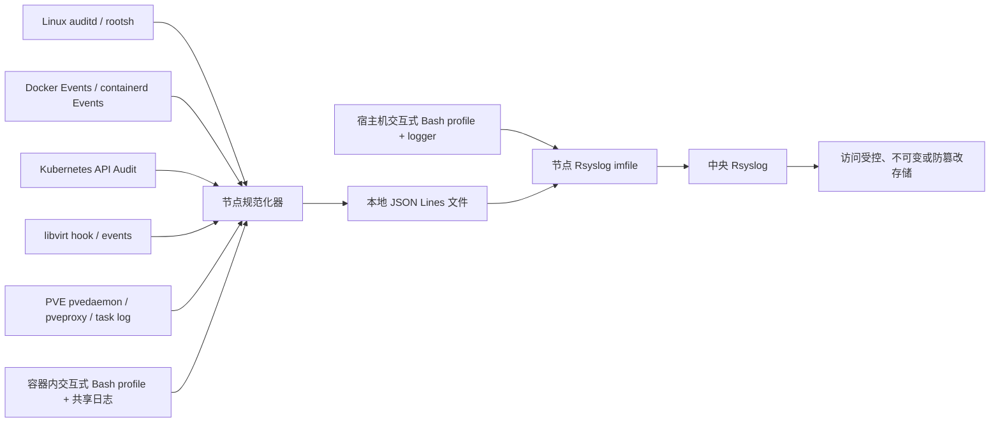

# 统一基础设施操作审计：设计与最小 PoC

状态：**隔离演示项目**。本项目没有修改主机、Docker、Kubernetes、KVM/libvirt 或 PVE 的运行配置，也没有启动服务。`src/normalize.py` 和 `src/collect_file.py` 是可运行的字段映射与文件持续采集 PoC；正式采集器、持久化、鉴权与传输加密仍需按环境实现和验收。服务器审计的本轮范围仅是**发送到 Rsyslog**，参见 [服务器转发说明](SERVER_FORWARDING.md)、[交付清单](DELIVERY.md) 和 [当前审计状态](CURRENT_STATUS.md)。

## 1. 架构与采集边界



| 面 | 主要记录 | 能回答的问题 | 边界 |
|---|---|---|---|
| Linux 主机 | auditd `execve`、身份/TTY/进程号；rootsh 会话输入输出 | 谁从主机执行了进程，某个受控 shell 会话中发生什么 | auditd 不等于完整 shell 命令历史；内建命令、别名及进程内行为无法靠 `execve` 完整表达。rootsh 仅覆盖实际经它启动的会话。 |
| Docker | Engine Events，尤其 `exec_create`、`exec_start`、容器生命周期 | 哪个容器发生了 exec/启停 | 事件通常不含操作者身份和容器内命令全文；需与 Docker API 入口身份、主机审计关联。事件回放只有最近 256 条，不能当可靠长期存储。 |
| Kubernetes | API Audit 中 `pods/exec`、`attach`、工作负载改动 | 谁经 API 请求进入 Pod 或改配置 | API Audit 记录的是 API 请求，不是进入后的每条命令；绕过 API 的节点运行时操作需节点侧事件。 |
| 容器运行时 | containerd Events / CRI 相关节点日志 | 任务创建、启动、退出等 | 实际输出与版本/运行时相关；需要容器 ID ↔ Pod UID/Namespace 的元数据映射。PoC 接受已结构化的事件。 |
| KVM/libvirt | QEMU hook 或 libvirt event callback | 虚机启停、迁移等生命周期 | hook 不是完整 API 调用审计，也未必有操作者身份；不能在 hook 中回调 libvirt，且 hook 出错可能阻断虚机操作。 |
| PVE | pvedaemon、pveproxy、任务 UPID/任务日志 | API 入口、任务及 VMID | 各版本日志格式不同；把 UPID 用作关联键，再与访问日志及身份记录关联。PoC 接受解析后的任务对象。 |
| 容器内 Bash | `DEBUG` trap 在命令执行前记录 `BASH_COMMAND` | 已加载脚本的交互式 Bash 执行了什么 | 仅是辅助可见性，不能做强制审计。 |

**容器内 profile 结论：可采集，但有条件。** `/etc/profile` 适用于登录 Bash；`/etc/profile.d` 是否被加载取决于发行版 `/etc/profile`；非登录交互 Bash 通常读 `~/.bashrc`；`BASH_ENV` 由非交互 Bash 读取，本 PoC 即使被它加载也主动退出。`DEBUG` trap 记录简单命令执行前的文本，可能多条、重复或与用户输入不完全一致，不记录执行结果。`PROMPT_COMMAND` 在显示提示符前运行，适合按 history 取整行，但受历史记录设置和交互流程影响。两者都不能保障非交互进程、直接 `exec`、`sh`/`ash`、无 shell 镜像、跳过启动文件、被绕过或被篡改的会话。也不能保证有权限修改容器的用户无法删改日志。对 Kubernetes `kubectl exec`，优先以 API Audit 确认“谁进入了哪个 Pod”，再用容器内辅助记录补充会话行为。宿主机 `logger` 模式需设置 `INFRA_AUDIT_ENABLE=1`；容器文件模式需设置 `INFRA_AUDIT_SINK_FILE`。宿主机 logger 事件原样转发到 Rsyslog 的独立原始文件，尚未规范化。
本脚本遇到已有 `DEBUG` trap 会跳过安装，以免覆盖应用行为；之后其他脚本仍可覆盖它。

## 2. 字段标准与关联

规范见 `config/event.schema.json`。每行一个 JSON 对象。核心字段如下，未知值用 `null`，不能凭空填“用户”。

| 字段 | 含义和来源 |
|---|---|
| `time`, `observed_at`, `event_id`, `source` | UTC 源事件时间（缺失时为 `null`）、规范化器观察时间、源事件哈希 ID、采集源。PoC 的哈希用于去重演示，不是防篡改签名。 |
| `actor.user`, `actor.uid` | API 用户、登录审计 ID、PVE realm 用户或 shell 用户；运行时事件常为空。 |
| `host`, `tty` | 采集节点与终端；容器 hostname 不一定等于宿主机，需注入可信节点名。 |
| `container_id`, `pod`, `namespace`, `vm_id` | 资源标识；Pod 名不是稳定主键，生产版应再加 Pod UID/容器完整 ID。 |
| `action`, `target`, `result` | 动作、目标和结果。`shell.command.preexec` 只表示执行前观测，不能当执行成功。 |
| `correlation_id` | Kubernetes `auditID`、PVE UPID、Linux audit serial、rootsh/session ID 等。跨源关联还需时间窗口、节点、完整容器 ID/Pod UID。 |
| `details` | 来源特有字段。shell 的 `command_b64` 是 Base64 编码，**不是脱敏或加密**。 |

## 3. 威胁模型

保护目标是完整记录授权运维入口与关键控制面操作，并能发现采集缺口。对抗情形包括有容器 root 权限者绕过 profile、用 `sh -c` 或直接执行二进制、删除/篡改共享日志、修改环境变量伪造身份、短时间大量事件冲垮队列、断网和时钟漂移。profile 与 rootsh 都是可绕过的会话层；节点 root 或控制平面管理员还可能关闭 auditd、改 audit policy、停采集器。生产部署须限制审计配置变更权限、对采集器本身做健康与丢失监控、设置可靠本地缓冲和磁盘上限、同步时钟、按访问控制保留远端不可变副本。Rsyslog 传输应使用经双向身份验证的 TLS；本仓库的纯 TCP 配置仅供隔离实验室。

命令行、rootsh 终端输出和 Kubernetes Request/RequestResponse 级别审计可能包含口令、Token 或业务数据。此方案建议 Kubernetes policy 先使用 `Metadata`，限制 shell 原始内容的留存与读取权限，定义删改和保留策略。Base64 不降低泄露风险。

## 4. 最小运行步骤

在项目目录执行（仅写入临时目录）：

```sh
python3 src/normalize.py --input examples/events.jsonl --output /tmp/infra-audit-normalized.jsonl
python3 -m unittest discover -s tests -v
```

测试验证八种来源的映射、Kubernetes 身份与 Pod 关联、交互式 Bash 文件与 logger 两种输出、非交互 `BASH_ENV` 不捕获、绕过启动文件不捕获、文件增量转换，以及部署/回滚。测试不要求 root、Docker daemon 或 Rsyslog。

可选的**容器内**手动验证（会按需拉取测试镜像；仅在独立 Docker 测试环境执行）：

```sh
touch examples/container-events.jsonl
docker run --rm -it -v "$PWD:/poc" \
  -e INFRA_AUDIT_SINK_FILE=/poc/examples/container-events.jsonl \
  -e INFRA_AUDIT_POD=demo -e INFRA_AUDIT_NAMESPACE=lab \
  bash:5.2 bash --rcfile /poc/examples/bashrc -i
# 在容器提示符输入 echo hello、exit；随后查看 examples/container-events.jsonl
python3 src/normalize.py --input examples/container-events.jsonl
```

正式镜像若要使用 profile，必须确保实际进入的是 Bash、相应配置文件确实被加载、共享日志卷可写且采集器能读取。不要把测试中的可写日志文件视为可信审计源。`INFRA_AUDIT_CONTAINER_ID`、`INFRA_AUDIT_POD`、`INFRA_AUDIT_NAMESPACE` 可以由受控启动包装器/Downward API 注入，但环境变量本身可伪造，最终关联应使用节点侧可信元数据。

## 5. 采集对接与 Rsyslog

PoC 输入是 `{"source":"...","event":{...}}` JSON Lines，或者指定 `--source` 后直接给源事件 JSON Lines。例如：

```sh
docker events --format '{{json .}}' | python3 src/normalize.py --source docker --host node1 --output /var/log/infra-audit/normalized.jsonl
python3 src/normalize.py --source k8s_audit --host control1 --input /var/log/kubernetes/audit/audit.log --output /var/log/infra-audit/normalized.jsonl
```

上面是**接口示意**，不是可靠后台服务：文件追尾、断线重连、Docker 256 条回放限制、重复事件、日志轮转、落盘队列与权限需要生产采集器处理。Linux auditd 原始多行记录应按 serial 组装后送入 `auditd` adapter；rootsh 提取会话 ID/日志引用；PVE 从 pvedaemon、pveproxy、task log 提取 UPID/VMID/用户；libvirt 示例 hook 在 `scripts/libvirt-hook-example.sh`；containerd Events 应用节点 API 订阅后结构化。不要将 `ctr events` 的人类可读输出直接喂给 JSON adapter。

`config/rsyslog-forward-tls.conf.in` 和 `config/rsyslog-receiver-tls.conf.in` 是双向证书验证的 TLS 模板；`config/rsyslog-forward.conf.in` 与 `config/rsyslog-receiver.conf` 仅供实验室纯 TCP 演示。`imfile` 转发规范化文件；可选 `config/rsyslog-host-inputs.conf.in` 读取 auditd 与发行版认证日志；宿主机 logger 事件由系统现有 `imuxsock`/`imjournal` 输入接收并原样转发。接收端按来源分别保存原始文件。使用前需按实际路径、远端地址、证书身份、端口和队列磁盘空间审查配置，执行 `rsyslogd -N1 -f <完整配置文件>`，确认后再由管理员重载。本轮不做查询界面或数据展示。

## 6. 部署与回滚

脚本管理 `etc/profile.d/99-infra-audit.sh` 与 `etc/rsyslog.d/70-infra-audit.conf`，指定 `--host-input debian|rhel|custom` 时还会生成 `71-infra-audit-host-inputs.conf`。默认 TLS、默认仅显示计划；不会自动启用 auditd 规则、Kubernetes policy、libvirt hook、PVE 日志、创建日志文件或重启服务。建议先对临时根目录演练：

```sh
mkdir -p /tmp/infra-audit-root
python3 scripts/manage.py deploy --root /tmp/infra-audit-root --remote logs.example --port 10514
python3 scripts/manage.py deploy --root /tmp/infra-audit-root --remote logs.example --port 10514 --apply
python3 scripts/manage.py rollback --root /tmp/infra-audit-root
python3 scripts/manage.py rollback --root /tmp/infra-audit-root --apply
```

安装会保存原文件内容与权限，回滚只在目标仍与本次安装哈希一致时执行，避免覆盖后续管理员修改。实际根目录 `/` 还需显式 `--allow-live --apply`；本次未执行。登录 Bash 是否加载 `/etc/profile.d` 要在目标发行版确认；非登录 Bash 需单独从受控 `~/.bashrc` 加载。profile 只有设置 `INFRA_AUDIT_SINK_FILE` 且该文件预先存在、可写，或设置 `INFRA_AUDIT_ENABLE=1` 且 `logger` 可用时才产生记录。生产不要给普通用户可删改的审计文件赋予权威性。

## 7. 测试与上线验收清单

1. 同一操作者做主机 SSH/rootsh 操作、`docker exec`、`kubectl exec`、KVM 启停、PVE VM 启停；验证各源的时间、身份、节点、资源 ID 和关联键。
2. 对交互式 Bash（登录/非登录）、非交互 `bash -c`、`BASH_ENV`、`sh`/`ash`、直接 exec、无 shell 容器逐项验收捕获边界；尝试修改 trap 和日志文件，确认缺口告警。
3. 模拟 Rsyslog 不可达、磁盘满、轮转与采集器重启；核对丢失/重复计数、队列积压、恢复顺序和时钟偏差。
4. 验证 API Audit 的 `auditID`、PVE UPID、auditd serial、rootsh 会话 ID、容器完整 ID/Pod UID 与 VMID 关联；对无法确定用户的运行时事件保留 `null`。
5. 检查敏感命令及终端输出的访问控制、保留期、TLS、接收方鉴权，并用采集器停机/篡改事件测试监控。

## 8. 依据（官方资料）

- [GNU Bash startup files](https://www.gnu.org/software/bash/manual/html_node/Bash-Startup-Files)、[interactive behavior](https://www.gnu.org/software/bash/manual/html_node/Interactive-Shell-Behavior.html)
- [Linux audit rules](https://man7.org/linux/man-pages/man7/audit.rules.7.html)、[auditctl](https://man7.org/linux/man-pages/man8/auditctl.8.html)
- [rootsh 项目](https://github.com/jpschewe/rootsh)
- [Docker Events](https://docs.docker.com/reference/cli/docker/system/events/)
- [Kubernetes auditing](https://kubernetes.io/docs/tasks/debug/debug-cluster/audit/)
- [containerd events 命令实现](https://github.com/containerd/containerd/blob/main/cmd/ctr/commands/events/events.go)
- [libvirt hooks](https://www.libvirt.org/hooks.html)
- [Proxmox VE 管理手册](https://pve.proxmox.com/pve-docs/pve-admin-guide.pdf)、[pvedaemon](https://pve.proxmox.com/pve-docs/pvedaemon.8.html)
- [Rsyslog omfwd](https://docs.rsyslog.com/doc/configuration/modules/omfwd.html)、[TLS 配置](https://docs.rsyslog.com/doc/tutorials/tls.html)
